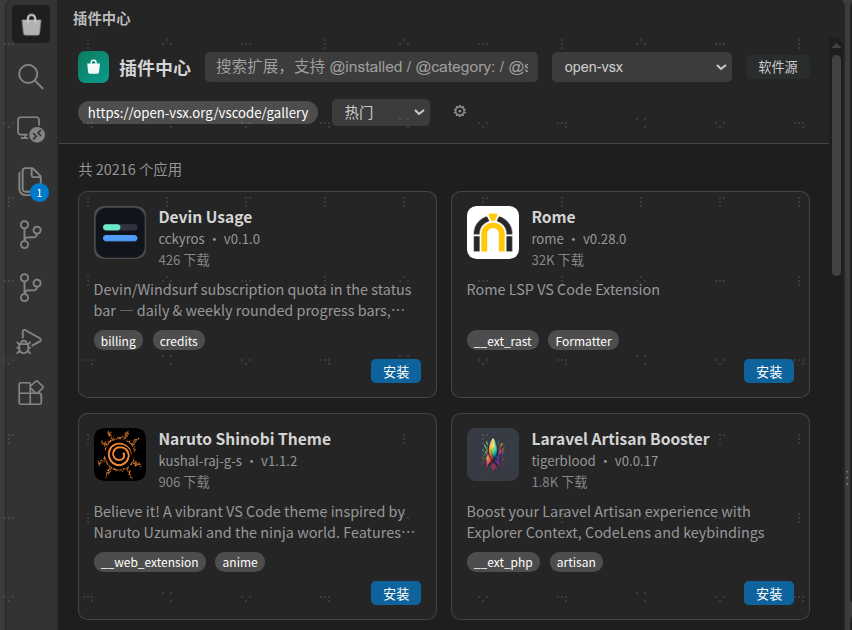

# 插件中心（appStoreHub）

**在 VS Code 内直接浏览、搜索、安装、更新与卸载扩展**，支持多软件源自由切换，开箱对接 VS Code 官方 Marketplace 与 Open VSX。

<small>最低支持 VS Code `1.77.0`</small>

 

---

## 界面预览

## 功能特性

- **可视化插件市场** — 活动栏一键打开，卡片网格浏览，支持搜索（防抖）、分类筛选与分页
- **独立详情页** — 在编辑器区以标签页查看扩展详情（版本 / 作者 / 安装量 / 评分 / 描述），README 与更新日志内置渲染
- **完整生命周期管理** — 安装、卸载、更新扩展，并支持选择并安装指定版本
- **多软件源** — 下拉框随时切换，界面上即可添加 / 删除软件源，每个源独立对接后端服务
- **标准 Gallery 协议** — 兼容 VS Code `extensionsGallery` 协议（`/extensionquery` / `vspackage` / `asset`），可对接任意实现该协议的后端
- **网络可靠性** — 原生 Socket 直连、失败自动重试、并发赛跑、可配置代理与超时；外部截图经代理下载后回传展示

## 使用

- **打开**：点击活动栏「插件中心」图标，或命令面板执行 *插件中心: 打开插件中心*
- **切换软件源**：顶部下拉框选择；点「软件源」可添加 / 删除 / 设为当前，配置持久化到 VS Code 设置
- **安装模式**：`auto`（默认，真实调用 VS Code 安装扩展）/ `manual`（仅记录状态）

**预置软件源**

| 软件源 | 地址 |
| --- | --- |
| VS Code Marketplace | `https://marketplace.visualstudio.com/_apis/public/gallery` |
| Open VSX | `https://open-vsx.org/vscode/gallery` |
| 本地开发源 | `http://127.0.0.1:3000` |

## 配置

在 VS Code 设置（`Ctrl+,`）中以 `appStoreHub.*` 前缀配置：

| 配置项 | 默认值 | 说明 |
| --- | --- | --- |
| `appStoreHub.sources` | 预置 3 个源 | 软件源列表 `[{ "label": "...", "url": "http(s)://..." }]`，可配置 `concurrent` 开启并发赛跑 |
| `appStoreHub.activeSource` | VS Code Marketplace | 当前激活的软件源地址 |
| `appStoreHub.installMode` | `auto` | 安装方式：`auto` / `manual` |
| `appStoreHub.proxy` | 空 | HTTP/HTTPS 代理地址；留空依次回退 `http.proxy` 与 `https_proxy` / `http_proxy` 环境变量 |
| `appStoreHub.retry` | `4` | 连接失败自动重试次数（写操作不重试） |
| `appStoreHub.connTimeout` | `20000` | 单次请求连接超时（毫秒） |
| `appStoreHub.debug` | `true` | 调试日志开关（含请求 URL、代理、耗时、重试与错误详情） |

## 常见问题

**一直「正在加载应用列表」？**
当前软件源不可达。受限网络下需配置 `appStoreHub.proxy`——注意 VS Code 从桌面图标启动时扩展进程不继承终端导出的代理变量，须在设置中显式配置。

**可以对接自己的扩展市场吗？**
可以。任意实现 VS Code `extensionsGallery` 协议的后端均可作为软件源添加。

## 许可证

[MIT](./LICENSE) · 更新日志见 [CHANGELOG.md](./CHANGELOG.md)

**致谢**

- [marked](https://github.com/markedjs/marked)（MIT）
- [DOMPurify](https://github.com/cure53/DOMPurify)（Apache-2.0 / MPL-2.0）
- [marked-gfm-heading-id](https://github.com/markedjs/marked-gfm-heading-id)（MIT）
